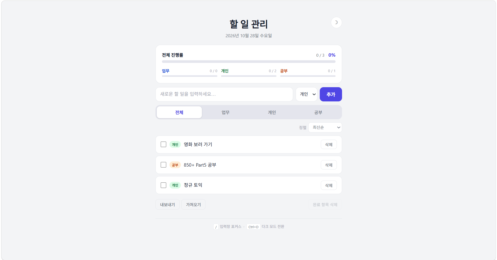

# 개인용 할 일 관리 앱 (personal-todo-app)

인공지능활용실습 4주 차 과제

순수 HTML·CSS·JavaScript로 구현한 개인용 할 일 관리 앱입니다.
프레임워크·라이브러리·CDN 없이 세 파일로 동작하며, `index.html`을 더블클릭하면 바로 실행됩니다.

## 주요 기능

| 기능 | 설명 |
|------|------|
| 할 일 추가 | 입력창에 입력 후 [추가] 버튼 또는 Enter |
| 완료 체크 | 체크박스로 완료/미완료 전환, 완료 항목은 취소선과 흐린 색 처리 |
| 수정 | 항목 더블클릭 또는 Enter/F2 키 → 인라인 편집 → Enter 저장 / Esc 취소 |
| 삭제 | 각 항목의 [삭제] 버튼 |
| 카테고리 | 업무·개인·공부 분류, 색상 배지로 구분 |
| 필터 | 전체·업무·개인·공부 탭으로 목록 필터링 |
| 정렬 | 최신순·오래된순·미완료 우선 |
| 진행률 대시보드 | 전체 및 카테고리별 완료 비율과 진행률 바 |
| 다크 모드 | 헤더 버튼 또는 Ctrl+D로 전환, 새로고침 후에도 설정 유지 |
| 완료 항목 일괄 삭제 | [완료 항목 삭제] 버튼, 확인 후 실행 |
| 내보내기 | 전체 할 일을 JSON 파일로 다운로드 (`todos-YYYY-MM-DD.json`) |
| 가져오기 | JSON 파일 선택 → 형식 검증 → 확인 후 목록 교체 |
| 단축키 | `/`: 입력창 포커스, `Ctrl+D`: 다크 모드 전환 |
| 자동 카테고리 분류 | 입력 키워드 실시간 분석 → 카테고리 자동 선택 + 힌트 표시 |

## 실행 방법

저장소를 클론한 뒤 `index.html`을 더블클릭하거나 브라우저 주소창에 파일 경로를 입력합니다. 빌드 도구나 서버 없이 바로 실행됩니다.

```
git clone https://github.com/merry715/personal-todo-app.git
```

> Chrome, Edge 최신 버전에서 테스트했습니다.

## 파일 구조

```
├── index.html                 HTML 구조, ARIA 접근성 속성
├── style.css                  CSS 변수(라이트/다크), 레이아웃, 반응형
├── script.js                  할 일 CRUD, 필터/정렬, 대시보드, 테마, 가져오기/내보내기
├── screenshot.png             앱 스크린샷 (모바일 최적화 원본)
├── todo-app-conversation.txt  Claude Code 전체 대화 기록
├── README.md                  프로젝트 문서
├── CLAUDE.md                  클로드 코드용 프로젝트 설명
└── web_version/               데스크톱 최적화 버전
    ├── index.html             2단 레이아웃 HTML (aside.sidebar + div.content)
    ├── style.css              데스크톱 전용 CSS (Grid, sticky 사이드바, 반응형)
    └── script.js             다크 모드 개선 반영
```

## 사용 기술

- **HTML5** — 시맨틱 마크업, `role`·`aria-*` 접근성 속성
- **CSS3** — CSS 커스텀 속성(변수), Flexbox, Grid, 미디어 쿼리, 트랜지션
- **JavaScript (ES2020)** — 순수 Vanilla JS, localStorage API, File API, Blob/URL API

모든 데이터는 브라우저 `localStorage`에 저장됩니다.

| 키 | 값 |
|----|-----|
| `todos` | 할 일 배열 (JSON) |
| `theme` | `"light"` 또는 `"dark"` |

## 단축키

| 키 | 동작 |
|----|------|
| `/` | 입력창에 포커스 (다른 입력 필드 활성 시 무시) |
| `Ctrl+D` | 라이트/다크 모드 전환 |
| `Enter` | 할 일 추가 / 수정 저장 |
| `Esc` | 수정 취소 |
| `Enter` 또는 `F2` | 목록 항목에 포커스한 채로 수정 모드 진입 |

## 할 일 객체 구조

```json
{
  "id":        "1790132400000",
  "text":      "할 일 내용",
  "category":  "personal",
  "completed": false,
  "createdAt": "2026-09-23T03:00:00.000Z"
}
```

`category`는 `"work"` · `"personal"` · `"study"` 중 하나이며, 잘못된 값은 `"personal"`로 자동 정규화됩니다.

## 자동 카테고리 분류

할 일을 입력하는 동안 텍스트를 실시간으로 분석해 카테고리를 자동으로 선택합니다.

### 동작 방식

1. `input` 이벤트마다 카테고리별 키워드 점수를 계산합니다.
2. 가장 높은 점수의 카테고리가 유일하면 드롭다운을 자동 전환하고 힌트를 표시합니다.
3. 동점이거나 매칭 키워드가 없으면 아무것도 변경하지 않습니다.

### 카테고리별 주요 키워드

| 카테고리 | 키워드 예시 |
|----------|-------------|
| 업무 | 회의, 보고서, 발표, 기획, 미팅, 프로젝트, 마감, 스프린트, 이메일, 결재 … |
| 공부 | 공부, 학습, 강의, 과제, 시험, 복습, 코딩, 프로그래밍, 자격증, 독서 … |
| 개인 | 운동, 쇼핑, 병원, 약속, 친구, 가족, 여행, 요리, 청소, 영화 … |

### 수동 우선 원칙

드롭다운을 직접 변경하면 자동 분류가 일시 중단됩니다. 입력창을 비우거나 할 일을 추가하면 다시 활성화됩니다.

## 데스크톱 버전 (web_version)

`web_version/` 폴더에는 데스크톱 전체 화면에 최적화된 버전이 있습니다. 원본과 동일한 기능을 제공하되 레이아웃과 다크 모드 동작을 개선했습니다.

### 2단 레이아웃

CSS Grid로 화면을 사이드바(300px)와 콘텐츠 패널(나머지)로 분리했습니다.

| 영역 | 포함 요소 |
|------|-----------|
| 왼쪽 사이드바 | 제목, 날짜, 테마 버튼, 진행률 대시보드, 단축키 안내 |
| 오른쪽 콘텐츠 | 할 일 입력, 필터 탭, 정렬, 목록, 내보내기/가져오기 |

사이드바는 `position: sticky`로 고정되어 목록이 길어져도 항상 보입니다. 뷰포트 너비 900px 이하에서는 자동으로 단일 컬럼으로 전환됩니다.



### 다크 모드 개선

원본 코드에서 발견된 두 가지 문제를 수정했습니다.

| 문제 | 수정 내용 |
|------|-----------|
| CapsLock 시 `Ctrl+D` 단축키 미작동 | `e.key === 'd'` → `e.key.toLowerCase() === 'd'` |
| 최초 방문 시 OS 다크 모드 설정 무시 | `localStorage` 저장값이 없을 때 `prefers-color-scheme` 미디어 쿼리로 OS 테마 자동 감지 |

FOUC 방지 인라인 스크립트(`<head>`)도 동일하게 수정해 최초 방문 시 화면 깜빡임을 방지했습니다. **이 개선 사항은 원본(`script.js`, `index.html`)에도 동일하게 반영되었습니다.**

### 대화 기록

`todo-app-conversation.txt` — 이 프로젝트의 전체 Claude Code 대화 내역을 내보낸 파일입니다.

## 개발 과정

클로드 웹에서 PRD와 단계별 프롬프트를 작성한 뒤, 클로드 코드로 아래 순서대로 구현했습니다.

- **Step 1** — 기본 구조 및 핵심 기능: 할 일 추가·완료·수정·삭제, localStorage 저장
- **Step 2** — 카테고리 기능 및 UI 개선: 업무·개인·공부 분류, 색상 배지, 필터 탭
- **Step 3** — 진행률 대시보드: 전체 및 카테고리별 완료율, 애니메이션 진행률 바
- **Step 4** — 다크 모드 및 고급 기능: 테마 전환, 완료 항목 일괄 삭제, 정렬, 단축키
- **Step 5** — 최종 완성 및 최적화: JSON 내보내기/가져오기, 반응형 레이아웃, 접근성 개선
- **Step 6** — 자동 카테고리 분류: 키워드 점수 기반 실시간 감지, 수동 우선 원칙, 힌트 UI
- **Step 7** — 데스크톱 버전 및 개선: `web_version` 2단 레이아웃(Grid + sticky 사이드바), 다크 모드 CapsLock·OS 자동 감지 수정
